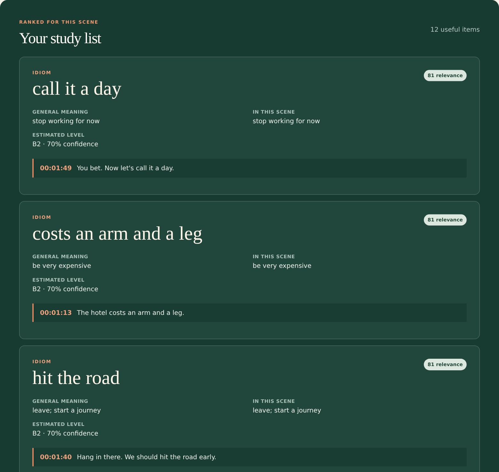
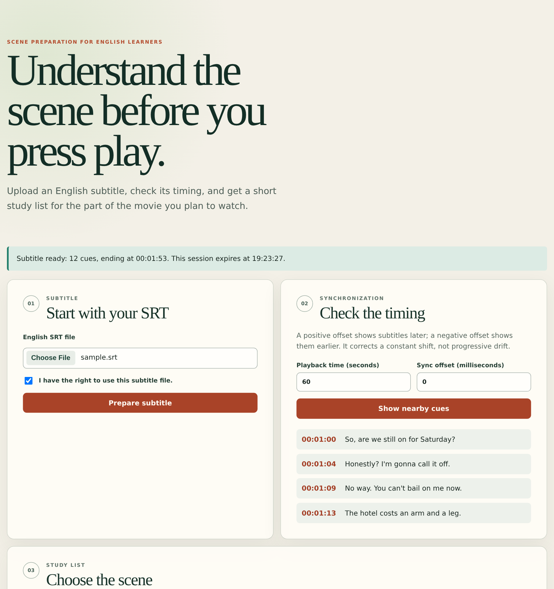
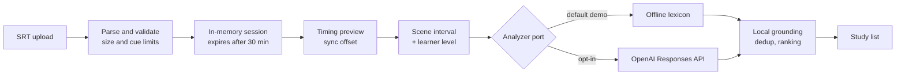

# Movie Language Helper

A web app that prepares English learners for a specific scene of a movie. You upload the English subtitle file, pick the part you are about to watch and your level, and it gives you a short ranked list of the idioms, phrasal verbs and slang in that scene, each one tied to the exact line where it is said.

The idea came from watching movies without subtitles: what stops you is rarely single words, it is expressions like "call it off" or "costs an arm and a leg" said at full speed. Reading them once before the scene helps a lot.



## Try it in two minutes (no API key)

```bash
make bootstrap   # installs locked Python and Node dependencies
make demo        # backend with the offline analyzer + frontend
```

Open http://127.0.0.1:5173, upload `examples/sample.srt`, tick the rights checkbox and press **Build my study list**. The demo uses a built-in lexicon instead of a language model, so it runs fully offline.



## How it works



1. **Parse.** The SRT is decoded (UTF-8, with a CP1252 fallback) and parsed with hard limits (file size, number of cues, characters per cue), markup is stripped and non-dialogue lines like `[music]` are flagged.
2. **Sync.** Subtitles and video are often a few hundred ms apart. The preview shows the lines around a playback time and lets you set a constant offset.
3. **Analyze.** Only the cues inside the chosen interval (max 10 minutes) are sent to the analyzer, plus a few neighbouring cues marked as context only.
4. **Ground and rank.** The analyzer output is treated as untrusted. Every expression must appear verbatim in the cue it cites, and expressions found only in context cues are rejected. Duplicates are merged and items are ranked by salience, confidence, distance from the learner's level and repetition. This step is deterministic and the same for every analyzer.

Two analyzers implement the same port:

| Analyzer | When | Notes |
|---|---|---|
| Offline lexicon | `MLH_LEXICON_ANALYZER_ENABLED=true` (used by `make demo`) | 89 curated expressions with inflection-aware patterns (`gave up`, `figure it out`, `pulling my leg`). No network. Meaning is the general one, it does not read the scene. |
| OpenAI Responses | `MLH_OPENAI_ENABLED=true` + key + model | Structured output validated against a schema, timeouts, typed failure codes. Explains the meaning in context. |

Optionally the app can search movies and download subtitles through SubDL (off by default). Downloaded archives go through a defensive unzip with limits on members, size and compression ratio.

## Architecture

The backend is hexagonal: `domain` (pure rules, no I/O), `application` (use cases), `ports` (interfaces) and `adapters` (HTTP, SRT parser, analyzers, SubDL, session store). A test parses every import and fails if a core layer imports an outer one or a third-party package, so the boundaries can't erode silently.

| Part | Stack |
|---|---|
| Backend | Python 3.12, FastAPI, Pydantic v2, pysubs2, uv |
| Frontend | React 19, TypeScript, Vite |
| Deployment | Docker, Compose, Caddy (TLS + auth at the edge) |
| Observability | Prometheus metrics, alert rules, Grafana dashboard |

More detail in [`docs/ARCHITECTURE.md`](docs/ARCHITECTURE.md), design decisions in [`docs/DECISIONS.md`](docs/DECISIONS.md), and a [threat model](docs/THREAT_MODEL.md).

## Quality checks

`make check` runs everything CI runs:

| Check | What |
|---|---|
| Backend | ruff (format + lint), mypy `strict`, 216 pytest tests, coverage must stay at 100% |
| Frontend | ESLint, `tsc`, Vitest unit tests, production build |
| Browser | Playwright end-to-end flow with axe accessibility checks (WCAG 2.1 AA) |
| Supply chain | locked dependencies, `uv audit` and `npm audit` in CI, license inventory, CycloneDX SBOM (`make dependency-sbom`) |
| Analyzer quality | evaluation harness for precision, recall, useful-at-N and unsupported-citation rate on a rights-cleared corpus (`docs/EVALUATION.md`) |

## Running it for real

```bash
make backend-dev    # API on :8000
make frontend-dev   # UI on :5173
```

Configuration is environment-based (`MLH_*`, see `.env.example`). Providers stay off unless explicitly enabled, credentials alone don't turn them on. For a private deployment with TLS and authentication, see [`docs/DEPLOYMENT.md`](docs/DEPLOYMENT.md) and [`docs/OPERATIONS.md`](docs/OPERATIONS.md).

## Limitations

- The offline lexicon only knows the expressions in it, and gives the general meaning.
- Sessions and rate limits live in one process: fine for a personal or small private deployment, not for an anonymous public service.
- You need the right to use the subtitle file you upload. The app does not play movies or export transcripts.

## License

MIT, see [LICENSE](LICENSE).
